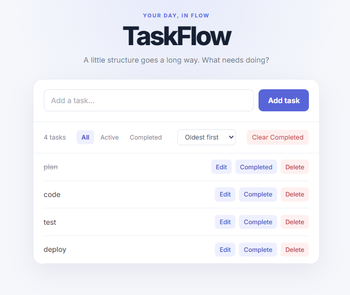

# TaskFlow

[](https://developer.mozilla.org/en-US/docs/Web/HTML)
[](https://developer.mozilla.org/en-US/docs/Web/CSS)
[](https://developer.mozilla.org/en-US/docs/Web/JavaScript)
[](LICENSE)

[](https://ali-ahmed-dev.github.io/taskflow/)

A simple and responsive task management application built with vanilla JavaScript, HTML, and CSS.

TaskFlow allows users to manage their daily tasks through a clean interface, with support for task editing, filtering, sorting, and persistent storage using LocalStorage.

## Preview



## Features

- Add, edit, complete, and delete tasks.
- Clear all completed tasks.
- Filter tasks by status (All, Active, Completed).
- Sort tasks by creation date.
- Save tasks using LocalStorage.
- Restore saved tasks when reopening the application.
- Dynamic DOM rendering.
- Input validation.
- Keyboard support for task editing.
- Focus management and accessible interactions.
- Responsive user interface.

## Technologies Used

- **HTML5** — Application structure.
- **CSS3** — Styling and responsive layout.
- **JavaScript (Vanilla)** — Application logic and DOM manipulation.
- **LocalStorage** — Client-side data persistence.

## Project Structure

```text
TaskFlow/
├── index.html
├── style.css
├── app.js
├── preview.png
├── README.md
└── LICENSE
```

## Getting Started

### 1. Clone the repository

```bash
git clone https://github.com/ali-ahmed-dev/taskflow.git
```

### 2. Navigate to the project directory

```bash
cd taskflow
```

### 3. Run the application

Open `index.html` in your browser.

No additional dependencies or installation steps are required.

## How to Use

1. Enter a task in the input field.
2. Click **Add Task** to create it.
3. Use **Edit** to modify an existing task.
4. Use **Complete** to change its status.
5. Use **Delete** to remove a task.
6. Filter tasks by their status.
7. Change the sorting order.
8. Use **Clear Completed** to remove all completed tasks.

Your tasks are automatically saved in LocalStorage.

## Security Considerations

- User-provided task text is rendered using `textContent` rather than `innerHTML`.
- Input values are trimmed before being processed.
- LocalStorage is used for local persistence and does not provide encryption.
- The application does not transmit task data to an external server.

## Concepts Practiced

This project was developed to practice and consolidate JavaScript fundamentals and browser-based programming concepts, including:

- Variables, functions, arrays, and objects.
- Array methods and data manipulation.
- DOM manipulation and dynamic rendering.
- Event handling and event listeners.
- State management.
- Browser Storage API.
- Keyboard interactions and focus management.
- Input validation.
- HTML semantics and accessibility.
- Responsive CSS design.

## Limitations

- Data is stored locally in the browser.
- No backend or database integration.
- No user authentication or cloud synchronization.
- Clearing browser storage may remove saved tasks.
- No automated test suite is currently included.

## License

This project is licensed under the [MIT License](LICENSE).

You are free to use, copy, modify, distribute, and adapt this project under the terms of the MIT License.

## Author

**Ali Ahmed**

- GitHub: [@ali-ahmed-dev](https://github.com/ali-ahmed-dev)
- Repository: [TaskFlow](https://github.com/ali-ahmed-dev/taskflow)

---

Built as a practical project to strengthen JavaScript and frontend development skills.